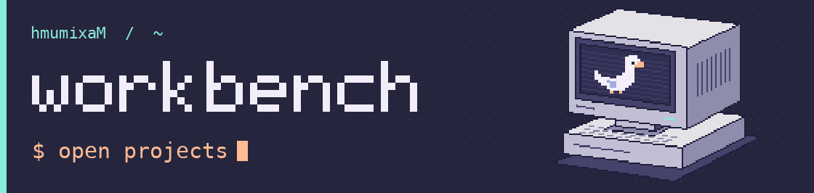

I’m **Yo**. I like tools that let me go back to the source. With **Stream Reducer**, that means jumping from a line of podcast notes to the recording. With **poly-us**, it means replaying an order book in the order the updates actually arrived.

[**Launch the project terminal**](https://hmumixam.github.io/hmumixaM/) · [Read an AI4 conference bulletin](https://reducer.xgoose.org/collections/ai4-2026?view=bulletin) · [Try xgoose in Chrome](https://xgoose.org/chrome/)

### On the workbench

- **[Stream Reducer](https://github.com/hmumixaM/stream-reducer)** · Follow a talk from video to transcript to a bulletin with timestamps. [Browse public collections](https://reducer.xgoose.org/collections)
- **[xgoose](https://github.com/xGoose-dev/xgoose)** · A browser agent that can read the current page and use skills written for individual sites. [Latest release](https://github.com/xGoose-dev/xgoose/releases/latest)
- **[Monica Next](https://github.com/hmumixaM/monica-next)** · A self-hosted notebook for people, conversations and the connections between them. [Explore the interface](https://hmumixam.github.io/monica-next/)
- **[poly-us](https://github.com/hmumixaM/poly-us)** · A Rust recorder for Polymarket US. It archives snapshots in Parquet and can replay them by arrival time.

中文简介

我是 Yo。我喜欢能追溯到原始记录的工具：读播客摘要时，可以点回说话的那一秒；研究行情时，可以按数据抵达的顺序重放盘口。我也做浏览器助手 xgoose 和自托管联系人笔记 Monica Next。打开[作品终端](https://hmumixam.github.io/hmumixaM/)，输入 <code>ls</code> 就能看到全部六个项目。

